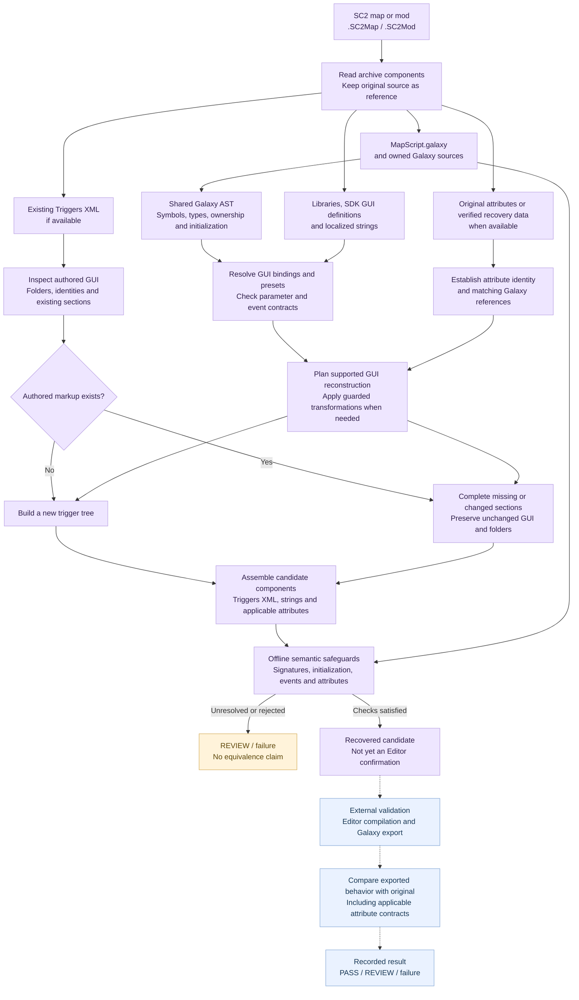

# SC2 Galaxy Trigger Recovery

> Earlier development branch. See the [current project page](https://github.com/VoVanRusLvSC2/SC2-Galaxy-Trigger-Recovery) for current source and releases.

**A reworked trigger recovery implementation, developed together with Vise.**

> **Status: source integration in progress.** This checkout is not yet a standalone, install-and-run converter. See the [source recovery status](SOURCE_STATUS.md) and [remaining work and release plan](ROADMAP.md).

**SC2 Galaxy Trigger Recovery** is a StarCraft II (SC2) trigger recovery project. It reconstructs editable GUI trigger markup (`Triggers` XML) from Galaxy source such as `MapScript.galaxy`, and completes missing or changed sections of an existing trigger tree.

The conversion core works with SC2 map and mod components (`.SC2Map` and `.SC2Mod`), library metadata and localized strings. Its goal is to preserve program behavior and existing GUI structure. Recovery depends on the available source and supported GUI bindings; compiled Galaxy alone cannot reveal every detail of the original authoring tree.

Start with the [converter architecture](ARCHITECTURE.md), [103 recorded strict-pass map records](maps/verified.md) and [222 historical acceptance records](maps/previously-accepted.md). See [integration status](#integration-status) before trying to build this source publication.

## Accepted map records

| Verification level | Archive records | Complete list |
| --- | ---: | --- |
| Last recorded strict MapScript pass | **103** | [Verified maps](maps/verified.md) |
| Accepted in the earlier registry | **222** | [Previously accepted maps](maps/previously-accepted.md) |

These are **325 accepted records from the main 339-record corpus**, with two explicitly different verification levels. They are not 325 new strict passes or necessarily 325 distinct publications. Original map names, archive IDs and SHA256 values are preserved in the lists and [machine-readable catalog](maps/catalog.json).

The last strict registry is dated **2026-10-30**. Publication and source reorganization do not constitute a new Editor run. Full gameplay, lobby and attribute acceptance is not claimed for every record.

## Core capabilities

- A shared Galaxy AST for functions, types, scopes and initialization.
- GUI binding resolution using library identity, element type, ID and ownership.
- Reconstruction of missing markup and incremental completion of existing trees.
- Preservation of original folders, separate Galaxy libraries and authored script in `preserve-source` mode.
- Attribute, dependency and localized-string recovery when supported by confirmed source data.
- Semantic safeguards for signatures, event arguments, initialization and exported program completeness.

## How trigger recovery works



This is the logical data flow, not a promise that every input is convertible. Attribute identity is prepared before GUI recovery; original attribute absence does not authorize inventing definitions. The default `preserve-source` mode retains authored script and separate libraries; `full-gui` is an explicit mode. Dashed arrows show the external validation workflow, whose Editor service and benchmark distributions are not bundled here. A candidate or successful compilation alone is not a strict equivalence pass.

See [Architecture](ARCHITECTURE.md#conversion-flow) for the implementation boundaries and [integration status](#integration-status) for the current build limitations.

## Source layout

```text
src/
  cli/            Conversion entry point
  ast/            Galaxy program model and syntax services
  utilities/      Recovered shared source and attribute helpers
  model/          Symbol identity and source ownership
  analysis/       Dependency and initialization analysis
  types/          Type inference and compatibility
  bindings/       Galaxy-to-GUI bindings
  gui/            GUI contracts and representation
  conversion/     Conversion stages
  incremental/    Existing-tree completion
  lowering/       Guarded source transformations
  verification/   Semantic safeguards used by the converter
  archive/        Archive and component handling
  libraries/      Shared library support
  sdk/            Included SDK source modules
  vendor/         Third-party runtime source
maps/             The 103 + 222 accepted-map lists
ARCHITECTURE.md   Design and integration notes
ROADMAP.md        Current blockers and working-release acceptance criteria
CONTRIBUTORS.md   Contributors and upstream acknowledgements
licenses/         Original third-party license notices
```

See [Architecture](ARCHITECTURE.md) for module responsibilities and entry points. This repository contains production source, accepted-map records and documentation; test suites, benchmark distributions, run logs and generated verification reports are not included.

## Integration status

The conversion core is implemented and has recorded results on real maps. The available source still has missing external dependencies and qualification inputs, so this is **not yet a complete standalone build**. Module paths have been reorganized for readability; historical results remain attached to the previously verified artifacts. No missing implementation is replaced by a stub, and the reorganization does not relax verification rules.

A source audit on **2026-11-14** found **339 unresolved relative-import references to 89 distinct targets** across the published JavaScript modules. These are import sites and targets, not 339 separate bugs or failing maps. Examples include the public entry point's re-export, shared utility modules and SDK internals. External runtime packages, machine-local SDK configuration and external benchmark inputs also need integration. The [roadmap](ROADMAP.md) sets out the order and completion criteria.

The readability update formats 782 project-owned modules and adds comments at the orchestration and contract boundaries. The 483 copied SDK/vendor modules and the map registry are unchanged. Syntax-tree comparison checks the formatting changes; it does not replace conversion benchmarks or a new Editor run. Historical source-hash evidence still needs qualification against a reproducible release build.

## Reading and formatting the source

Start with the [code reading guide](ARCHITECTURE.md#code-reading-guide). Project-owned JavaScript uses two-space indentation, a 100-column formatting target and explanatory comments for ownership, incremental recovery and verification boundaries. Copied SDK/vendor source is excluded from formatting.

To install **formatting tooling only** and check or apply the style:

```sh
npm ci
npm run format:check
npm run format
```

These commands do not install a complete converter runtime or resolve the integration blockers above. The formatter is pinned in the development dependencies and lockfile.

## Galaxy to GUI trigger recovery: common questions

### Can MapScript.galaxy be converted back into GUI triggers?

For supported constructs, this project reconstructs editable trigger markup from Galaxy using an AST and SC2 GUI library definitions. This is reverse reconstruction of trigger behavior, rather than recovery of an exact original XML file in every case. Unsupported or unproved cases still require review.

### How does this differ from the StarCraft II Editor's script export?

The Editor generates Galaxy from GUI triggers. SC2 Galaxy Trigger Recovery tackles the reverse direction: Galaxy source to editable GUI trigger elements. Library definitions, types, ownership and initialization relationships help determine the appropriate GUI representation. See the [conversion flow](ARCHITECTURE.md#conversion-flow).

### Can it complete or repair an existing Triggers tree?

Incremental completion selects missing or changed authored sections and preserves unchanged sections and existing folders. It does not need to rebuild the entire GUI tree for every edit. See the [preservation rules](ARCHITECTURE.md#preservation-rules).

### Will it recover original folder names, comments and all Custom Script as GUI?

Original structure can be preserved when the corresponding markup is available. Names, comments and folders lost from the available sources cannot generally be inferred from Galaxy alone. The default `preserve-source` mode retains authored Custom Script and separate Galaxy libraries; translating those sections belongs to the explicit `full-gui` mode and depends on supported representations.

### Does successful compilation prove the recovered map behaves identically?

Compilation checks whether code is accepted; it does not prove that initialization, events, side effects or attributes are equivalent. The [map records](maps/catalog.json) distinguish recorded strict MapScript passes from historical acceptances. They do not claim complete gameplay or attribute verification for every map.

### Where are the source code and download instructions?

Browse [the source modules](src/) and [integration entry points](ARCHITECTURE.md#entry-points). This checkout is not yet a self-contained application; its missing dependencies are noted above. [Earlier packaged releases](https://github.com/VoVanRusLvSC2/SC2-Galaxy-Trigger-Recovery/releases) are separate from the reworked source tree.

## Contributors and reverse engineering

The reworked implementation was developed together with **Vise**. Thanks to **[hometlt](https://github.com/hometlt)** for the upstream [ModKit/Blizzard libraries](https://github.com/hometlt/modkit-extensions-blizzard) used in this project.

Development included reverse engineering and analysis of SC2 formats, Galaxy, NativeLib, GUI bindings, event ABI and actual Editor exports. [Contributors](CONTRIBUTORS.md) and [third-party notices](THIRD_PARTY_NOTICES.md) document attribution.

Earlier packaged application releases remain available under [Releases](https://github.com/VoVanRusLvSC2/SC2-Galaxy-Trigger-Recovery/releases); they are separate from this reworked source publication.
