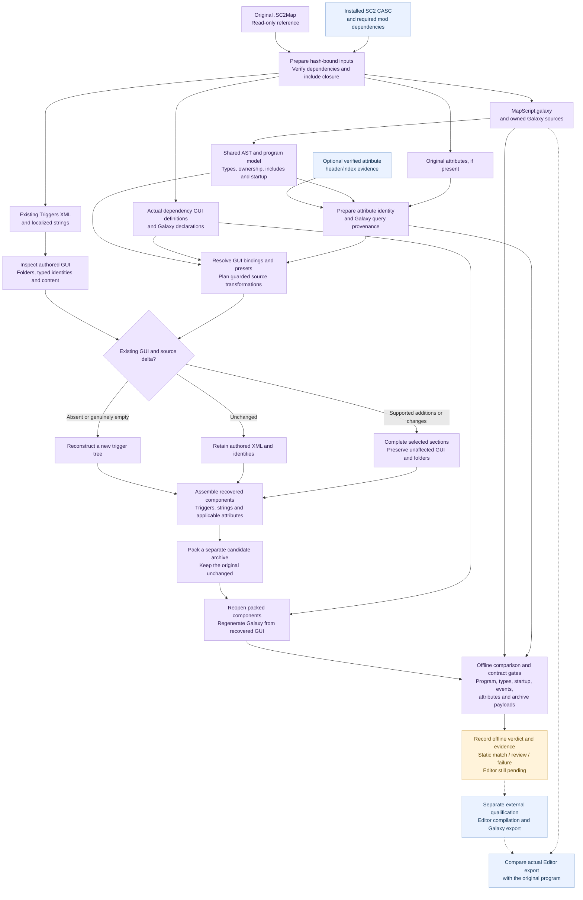

# SC2 Galaxy Trigger Recovery

> Earlier development branch. See the [current project page](https://github.com/VoVanRusLvSC2/SC2-Galaxy-Trigger-Recovery) for current source and releases.

**A reworked trigger recovery implementation, developed together with Vise.**

> **Windows release candidate: installer, portable app and reproducible public build.** See [Install and run](INSTALL.md), [build instructions](BUILDING.md), [source status](SOURCE_STATUS.md) and [remaining qualification](ROADMAP.md). Node and runtime dependencies are bundled; game metadata comes from your installed SC2.

**SC2 Galaxy Trigger Recovery** is a StarCraft II (SC2) trigger recovery project. It reconstructs editable GUI trigger markup (`Triggers` XML) from Galaxy source such as `MapScript.galaxy`, and completes missing or changed sections of an existing trigger tree.

The conversion core works with SC2 map and mod components (`.SC2Map` and `.SC2Mod`), library metadata and localized strings. Its goal is to preserve program behavior and existing GUI structure. Recovery depends on the available source and supported GUI bindings; compiled Galaxy alone cannot reveal every detail of the original authoring tree.

Start with the [converter architecture](ARCHITECTURE.md), [103 recorded strict-pass map records](maps/verified.md) and [222 historical acceptance records](maps/previously-accepted.md). See [integration status](#integration-status) before trying to build this source publication.

## Accepted map records

| Verification level | Archive records | Complete list |
| --- | ---: | --- |
| Last recorded strict MapScript pass | **103** | [Verified maps](maps/verified.md) |
| Accepted in the earlier registry | **222** | [Previously accepted maps](maps/previously-accepted.md) |

These are **325 accepted records from the main 339-record corpus**, with two explicitly different verification levels. They are not 325 new strict passes or necessarily 325 distinct publications. Original map names, archive IDs and SHA256 values are preserved in the lists and [machine-readable catalog](maps/catalog.json).

The last strict registry is dated **2026-10-30**. Publication and source reorganization do not constitute a new Editor run. Full gameplay, lobby and attribute acceptance is not claimed for every record.

## Core capabilities

The [TypeScript GUI](gui/README.md) provides adapter-based recovery, live logs,
evidence, an XML hierarchy and source previews without Java. Run `npm run gui`
from a prepared source checkout. Only the SC2 backend is currently implemented.
The published RC1 installer still contains the earlier native Windows form;
the TypeScript interface is included in RC2 and newer builds.

- A shared Galaxy AST for functions, types, scopes and initialization.
- GUI binding resolution using library identity, element type, ID and ownership.
- Reconstruction of missing markup and incremental completion of existing trees.
- Preservation of original folders, separate Galaxy libraries and authored script in `preserve-source` mode.
- Attribute, dependency and localized-string recovery when supported by confirmed source data.
- Semantic safeguards for signatures, event arguments, initialization and exported program completeness.

## How trigger recovery works

This diagram follows the packed-map CLI (`recover`). The component API exposes
GUI conversion and incremental completion for map or mod-library components;
its caller supplies the components and metadata instead of invoking the archive
preparation/packaging stages. See [API.md](API.md) and [CLI.md](CLI.md).



This is a logical data flow, not a claim that every stage uses one AST instance
or that every Galaxy construct is representable. Attribute identity is prepared
before GUI recovery; an attribute query alone does not authorize inventing
map-owned definitions. The default `preserve-source` mode retains authored script
and separate libraries; `full-gui` explicitly requests expanded reconstruction.
The three GUI branches describe preservation-mode routing. Unknown authored
metadata is preserved or refused; unsupported declaration changes and function
deletions are not silently handled by replacing the whole tree.

The archive worker regenerates Galaxy from the **packed** GUI and compares it
with the original using the applicable program, type, initialization, event,
attribute and payload contracts. Its variant verdict is
`STATIC_MATCH_EDITOR_PENDING`, `REVIEW_REQUIRED_EDITOR_PENDING` or failure;
the top-level `GENERATED` status only means candidate generation completed.
The unchanged external benchmark is required where the strict attribute runtime
contract calls for it. Dashed arrows show separate Editor qualification, which
the offline worker does not execute. Neither candidate creation nor successful
compilation alone proves full behavioral equivalence.

See [Architecture](ARCHITECTURE.md#conversion-flow) for the implementation boundaries and [integration status](#integration-status) for the current build limitations.

## Source layout

```text
src/
  cli/            Conversion entry point
  ast/            Galaxy program model and syntax services
  utilities/      Recovered shared source and attribute helpers
  model/          Symbol identity and source ownership
  analysis/       Dependency and initialization analysis
  types/          Type inference and compatibility
  bindings/       Galaxy-to-GUI bindings
  gui/            GUI contracts and representation
  conversion/     Conversion stages
  incremental/    Existing-tree completion
  lowering/       Guarded source transformations
  verification/   Semantic safeguards used by the converter
  archive/        Archive and component handling
  libraries/      Shared library support
  sdk/            Included SDK source modules
  vendor/         Third-party runtime source
trigger-recovery.mjs  User-facing map preparation/recovery CLI
packaging/        Windows launcher and installer build
scripts/          Public dependency setup, build and focused checks
maps/             The 103 + 222 accepted-map lists
ARCHITECTURE.md   Design and integration notes
ROADMAP.md        Current blockers and working-release acceptance criteria
CONTRIBUTORS.md   Contributors and upstream acknowledgements
licenses/         Original third-party license notices
```

See [Architecture](ARCHITECTURE.md) for module responsibilities and entry points.
The source tree includes focused verification scripts; full external benchmark
distributions, map corpora, worker outputs and private run logs remain outside it.
Built applications and their release evidence are published separately in Releases.

## Integration status

The public build downloads a fingerprint-pinned licensed ModKit revision and locked npm dependencies. The Windows application includes Node.js and mpqcli, and the user-facing CLI automatically prepares packed maps from the actual installed SC2 libraries. Neither a private runtime ZIP nor the author's drive layout is needed.

Both API directions, six fresh/incremental conversion cases, five attribute cases and a complete real-map archive job were exercised with the public runtime. The real map retained its original Galaxy and unrelated payloads; its conservative REVIEW verdict was preserved. This is release-candidate integration evidence, not a new corpus-wide or Editor acceptance claim. The [103 + 222 registry levels](maps/catalog.json) are unchanged.

The installer supports Windows 10/11 x64. Automatic archive jobs currently target packed maps; mod-library work is exposed through the component API. Applicable strict attribute comparisons still require the original external benchmark and verified header evidence. See [remaining work](SOURCE_STATUS.md#remaining-release-work).

## Reading and formatting the source

Start with the [code reading guide](ARCHITECTURE.md#code-reading-guide). Project-owned JavaScript uses two-space indentation, a 100-column formatting target and explanatory comments for ownership, incremental recovery and verification boundaries. Copied SDK/vendor source is excluded from formatting.

To prepare the public dependencies and check or apply the style:

```sh
npm run setup:public
npm run format:check
npm run format
```

Run `npm run setup:public` before these commands on a fresh clone. The formatter is pinned in the development dependencies and lockfile.

## Galaxy to GUI trigger recovery: common questions

### Can MapScript.galaxy be converted back into GUI triggers?

For supported constructs, this project reconstructs editable trigger markup from Galaxy using an AST and SC2 GUI library definitions. This is reverse reconstruction of trigger behavior, rather than recovery of an exact original XML file in every case. Unsupported or unproved cases still require review.

### How does this differ from the StarCraft II Editor's script export?

The Editor generates Galaxy from GUI triggers. SC2 Galaxy Trigger Recovery tackles the reverse direction: Galaxy source to editable GUI trigger elements. Library definitions, types, ownership and initialization relationships help determine the appropriate GUI representation. See the [conversion flow](ARCHITECTURE.md#conversion-flow).

### Can it complete or repair an existing Triggers tree?

Incremental completion selects missing or changed authored sections and preserves unchanged sections and existing folders. It does not need to rebuild the entire GUI tree for every edit. See the [preservation rules](ARCHITECTURE.md#preservation-rules).

### Will it recover original folder names, comments and all Custom Script as GUI?

Original structure can be preserved when the corresponding markup is available. Names, comments and folders lost from the available sources cannot generally be inferred from Galaxy alone. The default `preserve-source` mode retains authored Custom Script and separate Galaxy libraries; translating those sections belongs to the explicit `full-gui` mode and depends on supported representations.

### Does successful compilation prove the recovered map behaves identically?

Compilation checks whether code is accepted; it does not prove that initialization, events, side effects or attributes are equivalent. The [map records](maps/catalog.json) distinguish recorded strict MapScript passes from historical acceptances. They do not claim complete gameplay or attribute verification for every map.

### Where are the source code and download instructions?

Browse [the source modules](src/), [API usage](API.md), [prepared CLI jobs](CLI.md) and [integration entry points](ARCHITECTURE.md#entry-points). Download this revision's installer or portable ZIP from [this repository's Releases](https://github.com/VoVanRusLvSC2/SC2-Galaxy-Trigger-Recovery/releases). See [INSTALL.md](INSTALL.md) for public-source builds and supported scope. [Earlier packaged releases](https://github.com/VoVanRusLvSC2/SC2-Galaxy-Trigger-Recovery/releases) are separate from the reworked source tree.

## Contributors and reverse engineering

The reworked implementation was developed together with **Vise**. Thanks to **[hometlt](https://github.com/hometlt)** for the upstream [ModKit/Blizzard libraries](https://github.com/hometlt/modkit-extensions-blizzard) used in this project.

Development included reverse engineering and analysis of SC2 formats, Galaxy, NativeLib, GUI bindings, event ABI and actual Editor exports. [Contributors](CONTRIBUTORS.md) and [third-party notices](THIRD_PARTY_NOTICES.md) document attribution.

Earlier packaged application releases remain available under [Releases](https://github.com/VoVanRusLvSC2/SC2-Galaxy-Trigger-Recovery/releases); they are separate from this reworked source publication.
