# SC2 Galaxy Trigger Recovery

**Galaxy to GUI trigger recovery for StarCraft II.** Convert `MapScript.galaxy` into editable `Triggers` XML for the SC2 Editor. The tool works with `.SC2Map` maps and `.SC2Mod` mods and preserves existing trigger folders and Custom Script where possible.

## Version 3.1.6

[Download 3.1.6 for Windows x64](https://github.com/VoVanRusLvSC2/SC2-Galaxy-Trigger-Recovery/releases/tag/v3.1.6)

- **Installed-SC2** uses data from your StarCraft II installation and can recover missing map lobby attributes.
- **Standalone** downloads a pinned metadata snapshot during setup and runs without StarCraft II. Its recovered output is marked for Editor review.

Open **`Open Recovery.cmd`** from the installed or extracted folder. Select a map or mod and click **Generate Triggers**. For a map, **Insert Triggers Into Map** downloads a recovered copy. The interface also offers a separate Triggers XML download. [Installation and launch guide](INSTALL.md)

Version 3.1.6 displays stored attribute defaults and can optionally fill missing defaults in recovered game attributes with their first known value. It also restores supported embedded helper libraries as editable map functions.

## How recovery works

Follow the connected pipeline from `MapScript.galaxy` to editable triggers and a recovered `.SC2Map`. Mod recovery uses the same converter for library header and body pairs. See [mod recovery](MOD_RECOVERY_STATUS.md).

```mermaid
---
config:
  flowchart:
    curve: linear
    nodeSpacing: 24
    rankSpacing: 22
    padding: 10
    wrappingWidth: 200
---
flowchart TB
    accTitle: StarCraft II trigger recovery pipeline
    accDescr: Follow a map from source preparation through Galaxy parsing, symbol and library resolution, GUI reconstruction, archive verification, and optional SC2 Editor checks.

    entry["1. Open an original .SC2Map<br/>Windows app or recover CLI"] --> job["Create an isolated job<br/>Record the source map hash"]
    job --> components["Read selected components<br/>Galaxy, Triggers XML, strings and Attributes"]
    components --> resolve["Resolve declared dependencies<br/>and nested Galaxy includes"]
    resources["Installed SC2 or Standalone data<br/>Map-owned libraries and matching local mods"] --> resolve
    resolve --> coverage{"Dependencies<br/>resolved?"}
    coverage -->|Prepared inputs| source
    coverage -->|Missing| draft["Try partial recovery<br/>Report missing packages and symbols<br/>Offer a draft or XML when available"]

    source["MapScript.galaxy<br/>and map-owned scripts"] --> parse["2. Build the Galaxy AST<br/>Declarations, expressions and statements"]
    parse --> symbols["Resolve names and types<br/>Track scopes, owners and library references"]
    parse -->|Syntax errors| diagnostics["Report source locations<br/>in SOURCE_DIAGNOSTICS.json"]
    symbols --> program["Build the typed program model<br/>Call relationships, control flow, events and startup"]

    program --> binding
    catalog["Resolved library declarations<br/>and native GUI definitions"] --> binding["3. Bind Galaxy to GUI<br/>Library and element IDs,<br/>parameters and presets"]
    binding --> lowering["Apply guarded transformations<br/>for supported GUI patterns"]
    program --> attributes
    evidence["Attributes, localized strings<br/>and optional verified evidence"] --> attributes["Trace map attribute queries<br/>to the corresponding map data"]
    lowering --> policy["Apply recovery policy<br/>Preserve Source or Full GUI"]
    attributes --> policy
    authored["Index existing Triggers XML<br/>Element IDs, folders, Custom Script and libraries"] --> route
    policy --> route{"Authored GUI state<br/>and source changes?"}
    route -->|Absent or empty| fresh["Build a new trigger tree"]
    route -->|Matches Galaxy| preserve["Retain authored markup<br/>and element identities"]
    route -->|Supported changes| complete["Update affected elements<br/>Keep the surrounding tree"]
    fresh --> assembled["Recovered components<br/>Triggers XML, strings and applicable attributes"]
    preserve --> assembled
    complete --> assembled

    assembled --> pack
    assembled --> xml["Download editable<br/>Triggers XML when available"]
    pack["4. Pack a separate map<br/>Verify preserved archive payloads"] --> reopen["Reopen the packed map<br/>Read back its actual components"]
    reopen --> generate["Regenerate Galaxy from packed GUI<br/>using matching library metadata"]
    generate --> compare["Compare with original Galaxy<br/>Check types, calls, events and startup"]
    reopen --> checks["Check GUI references,<br/>attribute bindings and archive contents"]
    compare --> benchmark["Run the strict benchmark<br/>where applicable"]
    benchmark --> verdict{"Offline verdict"}
    checks --> verdict
    verdict -->|Static match| match["Static checks matched<br/>Editor verification pending"]
    verdict -->|Review| review["Differences or missing proof<br/>Editor verification pending"]
    verdict -->|Failure| failure["Report diagnostics<br/>Offer a draft if available"]
    match --> recovered["Download recovered .SC2Map<br/>Inspect RESULT.json and evidence"]
    review --> recovered

    recovered -.-> editor["Compile in StarCraft II Editor<br/>and export Editor-generated Galaxy<br/>for separate comparison"]

    classDef stage fill:#dce9fd,stroke:#4d6b9b,stroke-width:2px,color:#172d50;
    classDef input fill:#e7eefb,stroke:#4d6b9b,color:#172d50;
    classDef process fill:#e0f4f1,stroke:#387e78,color:#103d3a;
    classDef output fill:#e6f3df,stroke:#58804b,color:#263f1f;
    classDef review fill:#fff0d2,stroke:#aa7435,color:#593b14;
    classDef error fill:#fce4e4,stroke:#ac5858,color:#622424;
    classDef editorStep fill:#eee7fc,stroke:#7760a8,color:#3b2c5a;
    class entry,parse,binding,pack stage;
    class resources,source,catalog,evidence,authored input;
    class job,components,resolve,coverage,symbols,program,lowering,attributes,policy,route,reopen,generate,compare,checks,benchmark,verdict process;
    class fresh,preserve,complete,assembled,xml,match,recovered output;
    class draft,review review;
    class diagnostics,failure error;
    class editor editorStep;
```

Preserve Source retains authored Custom Script and separate libraries where possible. Full GUI also tries to reconstruct supported functions and variables from embedded Galaxy libraries. Names, comments and folder information missing from all available inputs may be unrecoverable.

The source archive stays read-only. The dashed arrow marks the separate Editor check. See [architecture](ARCHITECTURE.md#conversion-flow) for the verification boundaries.

## Documentation

- [Architecture](ARCHITECTURE.md) and [mod recovery](MOD_RECOVERY_STATUS.md)
- [CLI](CLI.md), [API](API.md) and [build instructions](BUILDING.md)
- [Verified map records](maps/verified.md), [historical acceptance records](maps/previously-accepted.md) and [source provenance](SOURCE_STATUS.md)
- [Release history](https://github.com/VoVanRusLvSC2/SC2-Galaxy-Trigger-Recovery/releases)
- [Contributors](CONTRIBUTORS.md) and [third-party notices](THIRD_PARTY_NOTICES.md)
